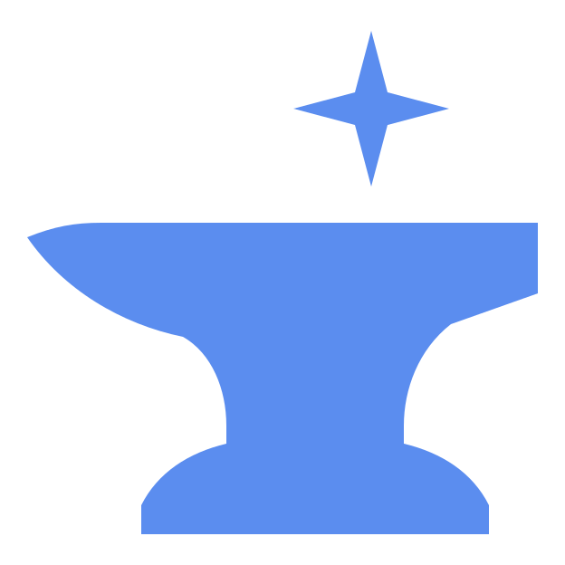

# Kothar

A desktop app for running coding agents.

Bring your own engines (coding-agent CLIs like Claude Code, Codex and pi) and drive them all from one place. Kothar
keeps a small core and lets you customize the rest with mods, which work with every engine.

## Mods

A mod is written once and works with every engine. It can add panels and commands, react to chats and turns, answer
permission requests, rewrite messages, and run commands, all through Kothar's public mod API. See
[docs/mods.md](docs/mods.md).

## Themes

Kothar ships with two themes, Default and Glass. More themes, such as Nord, Catppuccin and Gruvbox, come from the
marketplace in Settings. A theme is a small JSON file of colours, checked before it installs, so it can't change
anything but colours. The catalog lives in [marketplace/](marketplace/). Mods can't be installed from the marketplace
yet.

## Status

Early development. Nothing to install yet.

## License

- **Kothar's core, app and stock mods:** [Functional Source License 1.1, Apache 2.0 future licence](LICENSE.md)
  (FSL-1.1-ALv2). You may use, copy, modify and redistribute it for any purpose except a competing commercial
  product or service. Two years after each version is released, that version becomes Apache 2.0.
- **The mod API (`packages/mod-api`):** [MIT](packages/mod-api/LICENSE), so mods can use any licence they like.

Contributing: see [CONTRIBUTING.md](CONTRIBUTING.md).
