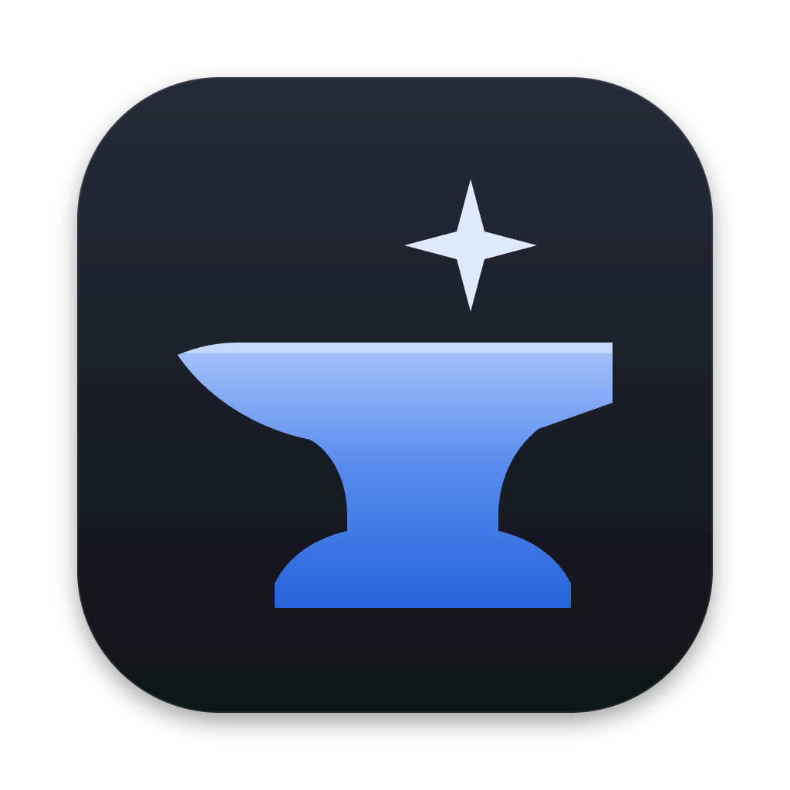

  

<h1 align="center">Kothar</h1>

A desktop app for running coding agents.

Bring your own engines (coding-agent CLIs like Claude Code, Codex, OpenCode and pi) and drive them all from one place. Kothar
keeps a small core and lets you customize the rest with extensions, which work with every engine.

## Extensions

An extension is written once and works with every engine. It can add panels and commands, react to chats and turns,
answer permission requests, rewrite messages, and run commands, all through Kothar's public extension API.

**Extension documentation:** [extension-documentation/](extension-documentation/index.md) covers using, building and
publishing extensions and themes, with the full API reference.

Community extensions install from the marketplace in Settings, from their authors' own repos. An extension is code, so
it lists what it uses through the extension API (running programs, reading chats, answering permission requests and so
on). Kothar shows that list before you install it, refuses to start an extension that does more than it listed, and
keeps every community extension off until you turn it on. Extensions load when Kothar starts, so turning one on takes a
restart.

**Writing an extension or theme:** start from the template
[billwang7599/kothar-sample-mod](https://github.com/billwang7599/kothar-sample-mod) (or
[kothar-themes](https://github.com/billwang7599/kothar-themes#make-your-own-theme) for a theme). Try it with **Install from
folder…** in the Marketplace window (**Browse…** in Settings → Community hub) before you publish, then follow the
[author guide](https://github.com/billwang7599/kothar-marketplace#submit-a-theme-or-extension) to list it.

## Setups

A setup is a saved choice for a kind of job: an engine and model with its thinking level, extensions to leave out, and
extra instructions. Make them in Settings → Setups and pick one for a space in its General tab. A worker always uses its
closest parent's setup, which is its space's, and can't pick its own. A setup applies from the chat's next message. A model or thinking level picked for the chat
itself still wins, and anything the setup leaves out follows Settings. Each setup is a plain JSON file in
`<garage>/setups/`.

A setup's instructions go into each session after the extensions' instructions and before the context items (the global
`AGENTS.md`, then each chat's), so your own `AGENTS.md` files read last. A setup can switch off extensions that are on,
for its chats only, but it can't turn on one that's off in Settings. Those chats don't get its tools, instructions,
panel tabs or commands. An extension with a chat of its own, such as Home,
always stays on in that chat, so the setup form doesn't list it.

## Themes

Kothar ships with two themes, Default and Glass. More themes, such as Nord, Catppuccin and Gruvbox, come from the
marketplace in Settings. A theme is a small JSON file of colours, checked before it installs, so it can't change
anything but colours.

The marketplace is a catalog of pointers in its own repo,
[billwang7599/kothar-marketplace](https://github.com/billwang7599/kothar-marketplace). Each entry names its author's own
repo, and Kothar installs from that repo's latest GitHub release, so authors own and update their work without a PR
here. Its README says how to publish and submit a theme or an extension.

## Status

Kothar is in early development, and there's no released build yet. It runs from source on macOS, in a browser tab or
as the desktop app; see [Running from source](CONTRIBUTING.md#running-from-source).

What works today:

- **Engines:** Claude Code, Codex, OpenCode and pi, with saved accounts for each.
- **Spaces:** a folder becomes a space whose lead agent streams its replies, tool calls and permission requests. Chats
  survive a restart.
- **Home:** a personal assistant that sees every space and can make new ones.
- **Workers:** a lead can hand tasks to workers that run beside it.
- **Memory:** every chat has its own.
- **Sandboxing (macOS):** agents work in a sandboxed work folder, with git folders checked out as worktrees.
- **Folder modes:** each attached folder that isn't a git repo has a mode, picked in the Context panel. **Edit in
  place** (the default) lets the sandbox write in the folder itself, though logins, keys and `.env` files in it still
  ask. **Work on a copy** copies it into the work folder once, and **Copy changes back** shows what the agents changed
  and copies your pick back, refusing to overwrite an original that changed since unless you confirm. **Read only**
  keeps agents out. A folder holding Kothar's own data is always read only. Each session's instructions list every
  folder with its mode, and a refused edit names the setting that would allow it.
- **Permissions:** switches decide what runs without asking.
- **File links:** a path in a chat that exists in its folders, checkouts or work folder is a link. Click opens it in
  your editor at its line (Settings → Work folder → Open files with: the system's default app, VS Code, Cursor,
  Windsurf, Zed, Sublime Text or a command of your own); right-click opens a terminal at its folder, shows it in
  Finder or copies the path.
- **Setups, themes, the marketplace,** and the built-in extensions in `extensions/`: Artifacts, Browser, Git, Home,
  Inspector, MCP servers, Memory, Notes, Pins, Plan, Processes, Reconnect, Skills, Deep Research and Account rotation. MCP servers connects
  GitHub, Linear, Notion and other MCP servers to every engine through Kothar, which is their only client, so keys stay in Kothar
  and each call is asked for and recorded. Pins puts a Pin button
  on each message; the Pinned tab lists the chat's pins and jumps back to one, loading older history if needed. Deep
  Research turns a question into a cited report: a plan you approve, workers that search and read the web, and only
  claims backed by a quote found on their page (a Deep research chip in the composer, New research ⌘⇧D, or the agent's
  `deep_research` tool). Plan adds a **Plan first** chip to the composer: the chat is read only (enforced by the
  sandbox and Kothar's permission answers, on every engine) until you approve the plan the agent hands in, and the
  Plan tab ticks its steps off as the work goes. Inspector shows what Kothar actually sent the engine for each message
  (See what was sent, beside the chat, and a Sent tab), each part labelled by who it's from, with Edit links to the
  extension prompts behind it; extensions' prompts and tool descriptions are editable on their Settings pages. Its
  Activity tab lists what Kothar and extensions do on their own: model calls, permission answers and the rule behind
  each, workers, retries and account switches.

Not built yet: remote machines, sandboxing outside macOS, a signed release, and sync.

## Building the Mac app

`npm run package` builds `packages/desktop/release/Kothar-<version>-arm64.dmg` (Apple
Silicon). With no signing setup it's ad-hoc signed, which runs on the Mac that built it; elsewhere macOS blocks it until
it's opened with right-click → Open. Signing and notarization switch on with environment variables:

- **Signing** (Developer ID certificate): `CSC_LINK` (path or base64 of a .p12) with `CSC_KEY_PASSWORD`, or `CSC_NAME`
  naming a certificate in the keychain.
- **Notarization** (needs signing too), one of: `APPLE_API_KEY` + `APPLE_API_KEY_ID` + `APPLE_API_ISSUER` (App Store
  Connect API key), `APPLE_ID` + `APPLE_APP_SPECIFIC_PASSWORD` + `APPLE_TEAM_ID`, or `APPLE_KEYCHAIN` +
  `APPLE_KEYCHAIN_PROFILE`.

To try a build beside your own Kothar, run it on a throwaway garage:
`KOTHAR_GARAGE=/tmp/k/garage KOTHAR_WORK=/tmp/k/work KOTHAR_USER_DATA=/tmp/k/data KOTHAR_PORT=4391 packages/desktop/release/mac-arm64/Kothar.app/Contents/MacOS/Kothar`.

## License

- **Kothar's core, app and built-in extensions:** [Functional Source License 1.1, Apache 2.0 future licence](LICENSE.md)
  (FSL-1.1-ALv2). You may use, copy, modify and redistribute it for any purpose except a competing commercial
  product or service. Two years after each version is released, that version becomes Apache 2.0.
- **The extension API (`packages/extension-api`):** [MIT](packages/extension-api/LICENSE), so extensions can use any
  licence they like.

Contributing: see [CONTRIBUTING.md](CONTRIBUTING.md).
